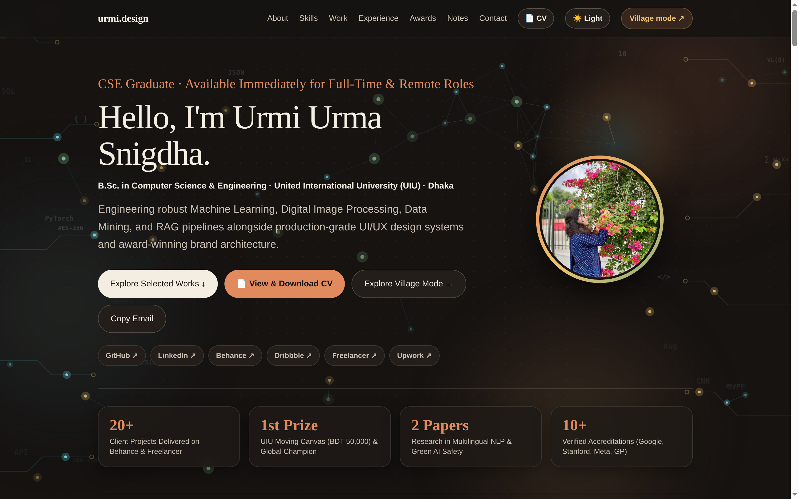
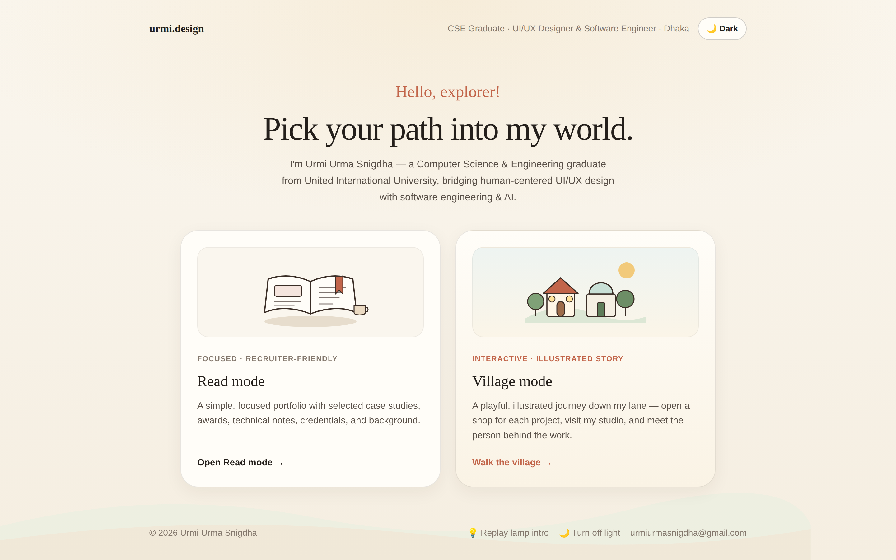
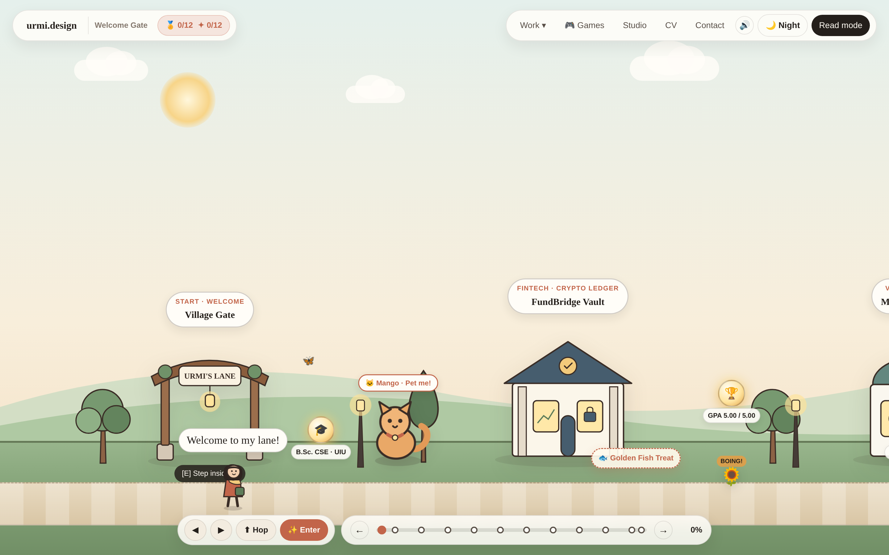
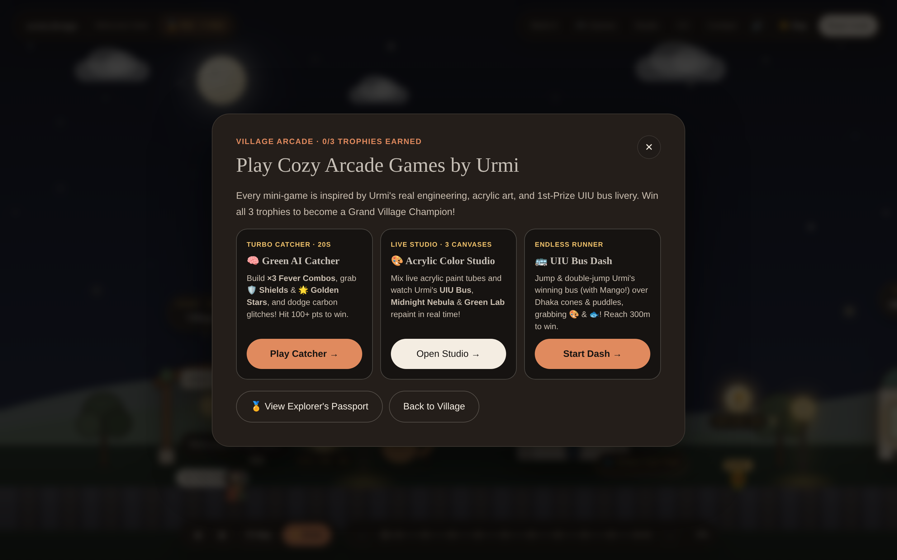
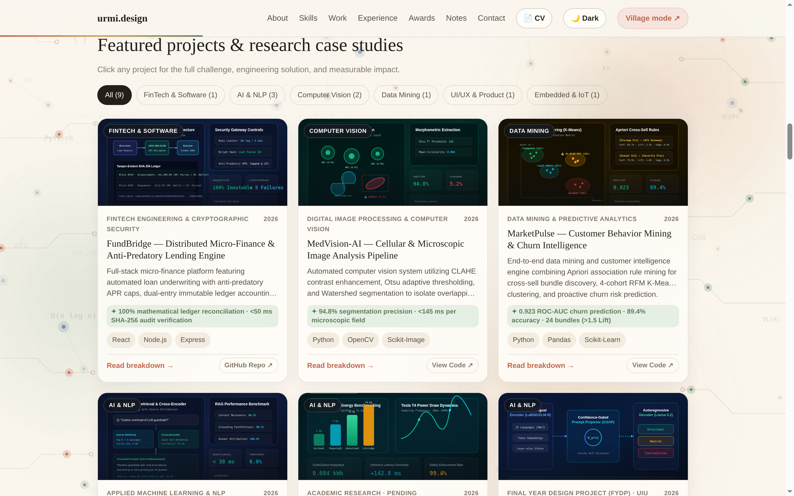
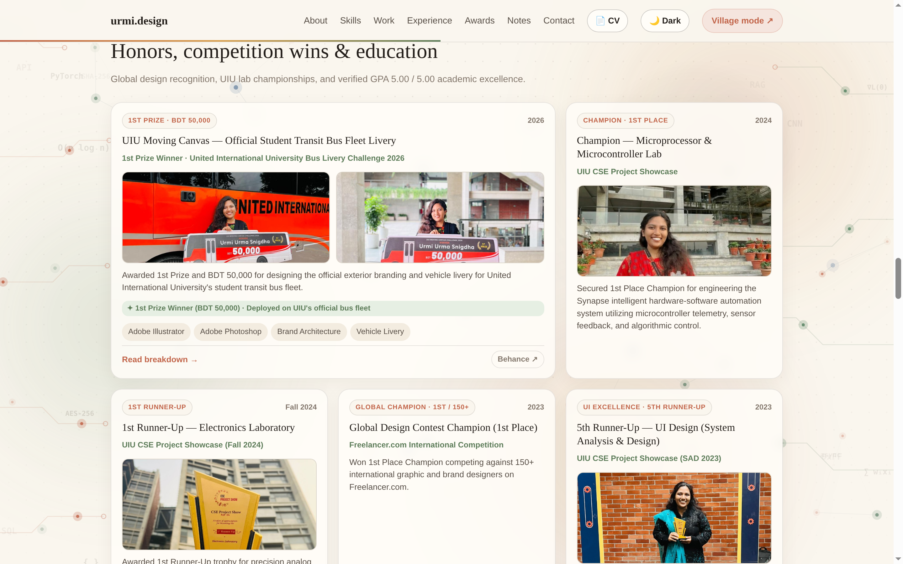
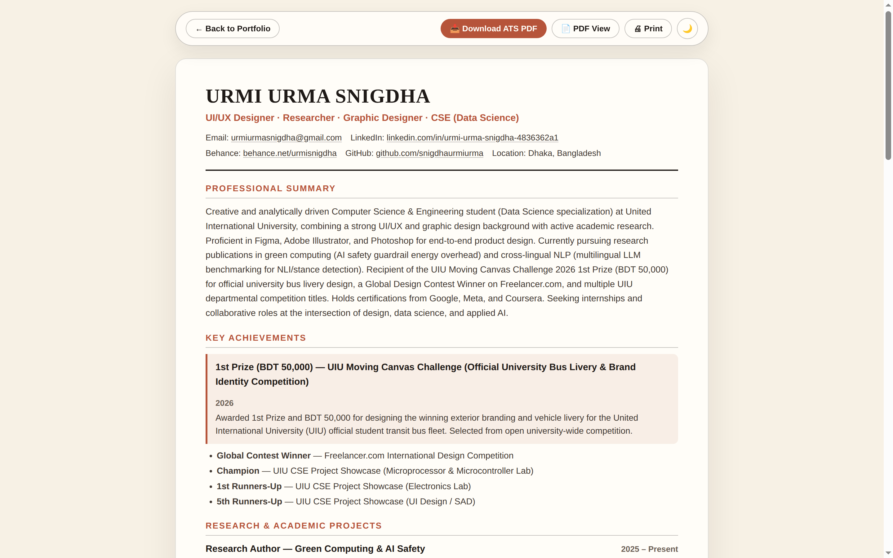

<div align="center">

# 🌿 Urmi Urma Snigdha — Dual-Mode Interactive Portfolio

**UI/UX Designer · AI & Data Science Researcher · Graphic Designer · CSE (United International University)**

[](https://urmi-village-repo.vercel.app)
[](https://urmi-village-repo.vercel.app/Urmi_Urma_Snigdha_CV.pdf)
[](https://www.linkedin.com/in/urmi-urma-snigdha-4836362a1/)
[](https://www.behance.net/urmisnigdha)

<br />

<a href="https://urmi-village-repo.vercel.app">
  
</a>

*An editorial, recruiter-ready CSE & Design portfolio paired with a playable side-scrolling illustrated Dhaka village adventure — deployed live on Vercel.*

</div>

---

## ✨ Visual Tour — Highlighted Experiences

### 1. Dual-Mode Entry & Cartoon Lamp Intro
Visitors are welcomed by an interactive lamp-pull opening and choose between **Read Mode** (focused, recruiter-friendly portfolio) or **Village Mode** (a playable illustrated journey down Urmi's Dhaka lane).

<p align="center">
  
</p>

---

### 2. Cozy Village Adventure Game 2.0 & Built-In Arcade
Walk Urmi down an illustrated Dhaka lane with **Mango the follower cat**, double-jump across **bouncy sunflowers**, collect **12 career knowledge orbs**, discover **hidden Dhaka secrets**, switch seamlessly between **Warm Daylight** and **Starlit Night Mode**, and play **3 custom mini-games**:
- 🧠 **Green AI Catcher Turbo** — Fever combos, shields, and carbon glitch dodging
- 🎨 **Acrylic Color Studio** — Live acrylic palette mixer repainting Urmi's canvases in real time
- 🚌 **UIU Bus Dash Runner** — Endless runner starring Urmi's 1st-Prize UIU student transit bus

<table>
  <tr>
    <td width="50%">
      
      <p align="center"><sub><b>Daylight Village Adventure</b> — Pet Mango, bounce on sunflowers &amp; enter project storefronts</sub></p>
    </td>
    <td width="50%">
      
      <p align="center"><sub><b>Starlit Night Village &amp; Arcade Hub</b> — 3 playable mini-games &amp; Explorer's Passport</sub></p>
    </td>
  </tr>
</table>

---

### 3. Featured Projects & Honors Showcase (Universal 3-Column Interactive Grid)
Every card features compact universal 3-column sizing, diagonal glass shine sweeps, an expanding terracotta-to-sage accent bar, a cursor-tracking radial spotlight glow, and staggered scroll-reveal transitions — all layered over a **live interactive CSE canvas** (PCB circuit pulses, neural network cursor synapses, floating algorithm glyphs, and hexagonal binary click ripples).

<table>
  <tr>
    <td width="50%">
      
      <p align="center"><sub><b>Featured Projects &amp; Research Case Studies</b> — Filterable 3-column showcase with full modal breakdowns</sub></p>
    </td>
    <td width="50%">
      
      <p align="center"><sub><b>Honors &amp; Competition Wins</b> — UIU Moving Canvas 1st Prize (BDT 50,000), UIU Lab Championships &amp; Global Champion</sub></p>
    </td>
  </tr>
</table>

---

### 4. Standalone ATS-Friendly CV (Normal View + 2-Page Vector PDF)
Completely self-contained inside this repository with **both** a clean web view ([`cv.html`](cv.html)) and a genuine, text-selectable **2-page ATS-scannable PDF** ([`Urmi_Urma_Snigdha_CV.pdf`](Urmi_Urma_Snigdha_CV.pdf)).

<p align="center">
  
</p>

---

## 🛠️ Key Features & Engineering Highlights

| Pillar | Highlights |
| :--- | :--- |
| **Dual-Mode Architecture** | Instant switching between **Read Mode** and **Village Mode** with persistent **Light / Dark Mode** across both views and the CV page. |
| **Live CSE Canvas Background** | Real-time HTML5 Canvas rendering PCB circuit traces with animated signal packets, an interactive neural network graph with cursor synapses, floating monospace CSE glyphs (`PyTorch`, `AES-256`, `RAG`, `O(n log n)`), and hexagonal click ripples. |
| **Village Adventure Game 2.0** | Side-scrolling SVG world with keyboard/touch controls, double-jump physics, Mango follower cat, collectible orbs, Explorer's Passport, Web Audio cozy chimes, and 3 playable arcade mini-games. |
| **Live Animated Skill Counters** | Scroll-triggered `IntersectionObserver` count-up KPIs and categorized technical/design skill matrices. |
| **Instant Live Email Delivery** | Direct Web3Forms integration + same-origin **Vercel Serverless Relay** ([`api/contact.js`](api/contact.js)) + 1-click Gmail Web compose fallback in both Read Mode and the Village Postbox. |
| **Standalone ATS CV + PDF** | Dedicated [`cv.html`](cv.html) with synced dark mode, print layout, and 1-click download of the 2-page selectable-text [`Urmi_Urma_Snigdha_CV.pdf`](Urmi_Urma_Snigdha_CV.pdf). |

---

## 📂 Repository Structure

```text
urmi-village-portfolio/
├── index.html                  # Full dual-mode portfolio (Read Mode + Village Adventure Game 2.0)
├── cv.html                     # Standalone ATS-friendly CV (Normal View Mode + Print/PDF controls)
├── Urmi_Urma_Snigdha_CV.pdf    # 2-page vector, selectable-text ATS PDF resume
├── api/
│   └── contact.js              # Vercel Serverless Function email relay (Web3Forms / Resend / FormSubmit)
├── docs/
│   └── screenshots/            # High-DPI portfolio screenshots featured in this README
└── backend/                    # Optional standalone PHP & Java contact backend references
```

---

## 🚀 Run Locally

```bash
git clone https://github.com/snigdhaurmiurma/urmi-village-portfolio.git
cd urmi-village-portfolio
python3 -m http.server 8080
```

Then open `http://localhost:8080` in your browser.

---

<div align="center">

**Let's build something meaningful together.**  
📧 [urmiurmasnigdha@gmail.com](mailto:urmiurmasnigdha@gmail.com) · 🌐 [urmi-village-repo.vercel.app](https://urmi-village-repo.vercel.app)

</div>
